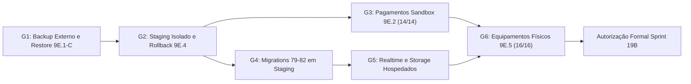

# Etapa 19A.1 — Plano Executivo de Desbloqueio dos Gates para o Piloto

**Data de Elaboração:** 10/11/2026  
**Escopo:** Organização executiva, dependências, roteiros de homologação e critérios formais de liberação (GO/NO-GO) dos gates bloqueantes que antecedem o Piloto Assistido (**Sprint 19B**).  
**Status Etapa 19A.1:** **GO — Plano Executivo Local Estruturado**  
**Status Sprint 19B (Piloto):** **NO-GO — Bloqueada até 6/6 Gates Individuais com GO**  
**Status Produção:** **NO-GO — Nenhuma operação remota executada**

---

## 1. Fase 1 — Inventário Verificado dos Gates e Evidências

Estado factual consolidado com base exclusivamente nos documentos e execuções já verificadas até a Sprint 19A, sem presumir testes não executados:

| Referência / Etapa | Situação Atual Verificada | Evidência Existente | Pendência Real |
| :--- | :--- | :--- | :--- |
| **Etapa 9E.1-B (Backup Lógico Cifrado)** | Backup gerado em `28/10/2026` (`stage9e1b-20261028152457`, AES-256-GCM, 23 arquivos / `6.064.833 bytes`, 18/18 objetos Storage, chave separada). | [STAGE_9E1B_LOGICAL_BACKUP.md](file:///c:/Sys_MArefeicoes/docs/STAGE_9E1B_LOGICAL_BACKUP.md), [validate-stage9e1b.cjs](file:///c:/Sys_MArefeicoes/scripts/stage9e/validate-stage9e1b.cjs) | Cópia externa/custódia física segregada da pasta de backup e da chave; backup não foi testado via restauração. |
| **Etapa 9E.1-C (Restauração Isolada)** | Roteiro definido (`9E.1`), **não executada** (`0/1` restaurações). Sem script próprio de restore `9E.1-C` criado em `scripts/stage9e/`. | [STAGE_9E1_BACKUP_RESTORE_RUNBOOK.md](file:///c:/Sys_MArefeicoes/docs/STAGE_9E1_BACKUP_RESTORE_RUNBOOK.md) | Provisionamento/isolamento do alvo + execução de restauração + comprovação de `RPO`, `RTO`, roles, Storage e `31/31` RLS. |
| **Etapa 9E.4 (Staging e Rollback Hospedado)** | Roteiro documentado, **não executado** (`0` ensaios). Ambiente hospedado isolado sem confirmação de exercício. | [STAGE_9E4_HOSTED_ROLLBACK_RUNBOOK.md](file:///c:/Sys_MArefeicoes/docs/STAGE_9E4_HOSTED_ROLLBACK_RUNBOOK.md) | Confirmar projeto/URL de staging separado de produção, variáveis isoladas, MFA e ensaio de rollback (`<= 30 min`). |
| **Etapa 9E.2 (Pagamentos Sandbox)** | Preflight local `14/14` aprovado (fail-closed ativo). Execução externa `PAY-01..PAY-14` em **`0/14`** por falta de credenciais sandbox (`ASAAS_API_KEY` / `MERCADOPAGO_ACCESS_TOKEN`). | [STAGE_9E2_PAYMENT_SANDBOX_PLAN.md](file:///c:/Sys_MArefeicoes/docs/STAGE_9E2_PAYMENT_SANDBOX_PLAN.md), [STAGE_9E2_PAYMENT_SANDBOX_EXECUTION.md](file:///c:/Sys_MArefeicoes/docs/STAGE_9E2_PAYMENT_SANDBOX_EXECUTION.md), [preflight-payment-sandbox.cjs](file:///c:/Sys_MArefeicoes/scripts/stage9e/preflight-payment-sandbox.cjs) | Credenciais oficiais de homologação (`$aact_hmlg_...` + segredo webhook HTTPS >= 32 chars) e aprovação `14/14`. |
| **Sprints 17.1 & 18 (Migrations 79–82 Locais)** | Migrations `79`–`82` validadas em PostgreSQL `17.11-5` descartável (`35/35` Sprint 17.1; `21/21 PG17 + 8/8` Sprint 18; `custody_drift = 0`). | [SPRINT_17_1_TRANSACTIONAL_HOMOLOGATION.md](file:///c:/Sys_MArefeicoes/docs/SPRINT_17_1_TRANSACTIONAL_HOMOLOGATION.md), [SPRINT_18_PERFORMANCE_STRESS_HOMOLOGATION.md](file:///c:/Sys_MArefeicoes/docs/SPRINT_18_PERFORMANCE_STRESS_HOMOLOGATION.md) | Aplicação controlada em **staging autorizado** e auditoria pós-aplicação remota. Permanecem apenas locais. |
| **Realtime e Storage Hospedados** | Remoção PII do Realtime (`operational_dashboard_signals`) e isolamento por `tenant_id` no bucket `contingency-evidence` validados em PG 17.11 local. | [SPRINT_17_SECURITY_FINANCIAL_AUDIT.md](file:///c:/Sys_MArefeicoes/docs/SPRINT_17_SECURITY_FINANCIAL_AUDIT.md) | Teste ponta-a-ponta no Supabase hospedado (WebSocket, polling fallback 30s e teste negativo cross-tenant em Storage). |
| **Etapa 9E.5 & Sprint 19A (Aceite Físico)** | Planejamento do piloto e matrizes `PHY-01..PHY-16` / `PIL-01..PIL-14` preparados (`build 33/33`, `tsc` e `eslint` `0` erros); **`0/16`** testes presenciais executados. | [STAGE_9E5_PHYSICAL_ACCEPTANCE_CHECKLIST.md](file:///c:/Sys_MArefeicoes/docs/STAGE_9E5_PHYSICAL_ACCEPTANCE_CHECKLIST.md), [SPRINT_19A_PILOT_PREPARATION.md](file:///c:/Sys_MArefeicoes/docs/SPRINT_19A_PILOT_PREPARATION.md) | Execução presencial no refeitório piloto com leitor USB HID, rede da universidade, usuários sintéticos e assinatura. |

---

## 2. Fase 2 — Matriz de Dependências, Ordem de Execução e Classificação

### 2.1 Sequência Obrigatória de Desbloqueio

### 2.2 Matriz Detalhada por Gate

| Ordem | Gate | Dependências | Responsável | Tipo de Ação | Evidência Obrigatória para GO |
| :---: | :--- | :--- | :--- | :--- | :--- |
| **1** | **G1 — Backup & Restauração (`9E.1-C`)** | Backup `9E.1-B` íntegro; espaço em disco; cópia externa da chave/backup | Infra / Master (**A DEFINIR**) | **Exige autorização + mídia externa** | Log `9e1-backup-restore`, `RPO`/`RTO` medidos, `31/31` RLS, `18/18` Storage por checksum, `0` escrita na origem |
| **2** | **G2 — Ambiente de Staging Isolado (`9E.4`)** | G1 aprovado (garantia de recuperação antes de alterações hospedadas) | Infra / DevOps (**A DEFINIR**) | **Exige infra hospedada + segredos de teste** | URL staging separada de produção, variáveis sintéticas, saúde `/api/health/ready`, rollback app `<= 30 min` |
| **3** | **G3 — Pagamentos Sandbox (`9E.2`)** | G2 ativo (endpoint HTTPS para webhook de teste) | Financeiro / Dev (**A DEFINIR**) | **Exige credenciais sandbox Asaas/MP** | Relatório `9e2-payment-sandbox` com **`14/14`** (`PAY-01..PAY-14`), ledger sem duplicidade, `0` transação real |
| **4** | **G4 — Migrations `79–82` em Staging** | G1 aprovado + G2 isolado | DBA / Master (**A DEFINIR**) | **Exige autorização explícita de schema em staging** | Saída de [stage19a1_migrations_79_82_readonly_checks.sql](file:///c:/Sys_MArefeicoes/scripts/sql/stage19a1_migrations_79_82_readonly_checks.sql) + `audit_wallet_custody_integrity` (`drift = 0`) |
| **5** | **G5 — Realtime e Storage Hospedados** | G4 aplicado em staging | Tech Lead / Segurança (**A DEFINIR**) | **Exige projeto staging Supabase** | Captura de sinal `operational_dashboard_signals` sem PII + fallback 30s + bloqueio HTTP `403/404` cross-tenant no bucket `contingency-evidence` |
| **6** | **G6 — Aceite Físico (`9E.5`)** | G3 + G5 aprovados; unidade escolhida; escala nominal | Operação / Presencial (**A DEFINIR**) | **Exige presença física no restaurante piloto** | Checklist `9e5-physical-acceptance` com **`16/16`** (`PHY-01..PHY-16`), leitor USB `50/50`, calibração real de `p50/p95/p99` |

### 2.3 Separação: Atividades Imediatas vs Dependentes de Recursos Externos

| Pode Ser Executado Imediatamente (Local / Offline / Sem Rede Remota) | Depende de Credenciais, Infraestrutura, Presença Física ou Autorização |
| :--- | :--- |
| Validação de integridade local do backup `9E.1-B` via [validate-stage9e1b.cjs](file:///c:/Sys_MArefeicoes/scripts/stage9e/validate-stage9e1b.cjs) | Cópia física externa da pasta do backup e chave + execução do restore isolado `9E.1-C` |
| Preflight offline de gates via [validate-stage19a1-preflight.cjs](file:///c:/Sys_MArefeicoes/scripts/validate-stage19a1-preflight.cjs) e [validate-stage9e-preparation.cjs](file:///c:/Sys_MArefeicoes/scripts/validate-stage9e-preparation.cjs) | Provisionamento/isolamento do projeto Supabase + deploy preview staging (Vercel) |
| Preflight local de pagamentos via [preflight-payment-sandbox.cjs](file:///c:/Sys_MArefeicoes/scripts/stage9e/preflight-payment-sandbox.cjs) | Obtenção de `ASAAS_API_KEY` (`$aact_hmlg_...`) e `ASAAS_WEBHOOK_SECRET` no painel sandbox |
| Regressões Sprints 14–18 (`validate-sprint18`, `homologate-sprint17-security`, etc.), `tsc`, `eslint`, `build` | Aplicação das migrations `79`–`82` em staging + teste WebSocket Realtime & Storage |
| Designação nominal da equipe piloto (`A DEFINIR` na Sprint 19A) e preparação de planilhas físicas Tipo A/B | Testes presenciais no equipamento da unidade universitária (`PHY-01..PHY-16`) e medição de rede local |

---

## 3. Fase 3 — Procedimentos de Homologação, Testes Negativos e Rollback

### 3.1 Gate G1 — Backup Externo e Restauração Isolada (`9E.1-C`)
- **Preflight Read-Only Local:**
  1. Executar `node scripts/stage9e/validate-stage9e1b.cjs` e verificar `1,86 GB` livres em `C:` (`>= 1,60 GB` para binários portáteis caso restaurado em PostgreSQL 17 descartável).
  2. Comprovar custódia da cópia externa do diretório `stage9e1b-20261028152457` e da chave em mídia separada.
- **Execução Futura Autorizada:** Restaurar somente em projeto Supabase de recuperação novo OU cluster PostgreSQL 17 descartável em loopback (`127.0.0.1`), mantendo integrações/cron/webhooks bloqueados.
- **Testes Negativos Obrigatórios:** Recusar imediatamente caso o destino coincida com `Sys_refeições`, haja escrita na origem, ou falte autenticação GCM/checksum de algum dos `18` objetos de Storage.
- **Pós-Validação e Limpeza:** Reconciliar schema, executar `audit_wallet_custody_integrity` e confirmar ausência de processos/arquivos decifrados temporários em disco ao concluir.

### 3.2 Gate G2 — Staging Isolado e Rollback Hospedado (`9E.4`)
- **Preflight Read-Only:** Verificar variáveis de staging em escopo restrito (`DEFAULT_PAYMENT_PROVIDER` sem fallback produtivo, `ASAAS_SANDBOX=true`, URL Supabase distinta da produção, promoção automática desligada).
- **Execução Futura Autorizada:** Seguir [STAGE_9E4_HOSTED_ROLLBACK_RUNBOOK.md](file:///c:/Sys_MArefeicoes/docs/STAGE_9E4_HOSTED_ROLLBACK_RUNBOOK.md) publicando versão estável `A`, promovendo `B`, simulando erro reversível somente na camada web e acionando Instant Rollback para `A`.
- **Testes Negativos Obrigatórios:** Validar que provedor `mock` é rejeitado em runtime `NODE_ENV=production` (`PAY-12`), que `SUPABASE_SERVICE_ROLE_KEY` não aparece no bundle público e que rollback web não altera banco/Storage.

### 3.3 Gate G3 — Pagamentos Sandbox (`9E.2`)
- **Preflight Read-Only Local:** Rodar `node scripts/stage9e/preflight-payment-sandbox.cjs` validando ausência de fallback silencioso e formato de chave de homologação.
- **Execução Futura Autorizada:** Com credenciais sandbox autorizadas, executar `PAY-01` a `PAY-14` ([STAGE_9E2_PAYMENT_SANDBOX_PLAN.md](file:///c:/Sys_MArefeicoes/docs/STAGE_9E2_PAYMENT_SANDBOX_PLAN.md)).
- **Testes Negativos Obrigatórios:**
  - `PAY-05`: Webhook com assinatura inválida retorna `HTTP 401` e `0` crédito.
  - `PAY-06`: Segredo ausente falha fechado (`fail-closed`).
  - `PAY-07`: Mesmo `event_id` repetido mantém apenas 1 lançamento no ledger.
  - `PAY-13`: Valor ou referência divergente é recusada e auditada.
- **Pós-Validação:** Executar `run_financial_reconciliation_audit` e `audit_wallet_custody_integrity` confirmando `custody_drift = 0`.

### 3.4 Gate G4 — Migrations `79–82` em Staging
- **Preflight Read-Only:** Executar `node scripts/validate-stage19a1-preflight.cjs` + validar integridade sequencial `79 -> 80 -> 81 -> 82` antes da janela em staging.
- **Execução Futura Autorizada:** Aplicar `79`, `80`, `81` e `82` exclusivamente em **staging autorizado** após aprovação de G1 e G2.
- **Pós-Validação Read-Only Obrigatória:** Rodar integralmente [stage19a1_migrations_79_82_readonly_checks.sql](file:///c:/Sys_MArefeicoes/scripts/sql/stage19a1_migrations_79_82_readonly_checks.sql) comprovando:
  - `rls_enabled = true` e `force_rls_enabled = true` nas tabelas críticas;
  - `operational_dashboard_signals` única tabela publicada em `supabase_realtime`;
  - Todos os 5 triggers de imutabilidade/sinalização ativos e 4 índices da Migration 82 válidos (`indisvalid = true`);
  - `anon_can_exec = false` e `public_can_exec = false` nas 6 RPCs críticas.
- **Critérios de Rollback SQL:** Caso ocorra falha durante ou imediatamente após aplicação **sem dados financeiros novos gravados**, executar `DROP INDEX IF EXISTS` para os 4 índices da Migration 82 seguido de [sprint17_1_rollback_79_80_81.sql](file:///c:/Sys_MArefeicoes/scripts/sql/sprint17_1_rollback_79_80_81.sql) (que bloqueia automaticamente via `ROLLBACK_BLOCKED_DATA_EXISTS` se houver dados). Havendo registros reais/válidos, adotar apenas correção *forward-only* ou restore de G1.

### 3.5 Gate G5 — Realtime e Storage Hospedados
- **Execução Futura Autorizada:** Com G4 aplicado em staging, abrir `/admin/dashboard` autenticado e disparar consumo + bloqueio sintéticos via `/terminal`.
- **Testes Negativos Obrigatórios:**
  - Inspecionar frame WebSocket do Supabase Realtime comprovando que **nenhum campo PII** (`student_id`, `full_name`, `registration_number`, `full_price`) trafega — apenas `unit_id`, `signal_type`, `emitted_at`.
  - Bloquear WebSocket no DevTools e confirmar transição para **Modo Resiliente (polling 30s)** sem afetar `/terminal`.
  - Tentar upload/leitura em `contingency-evidence` usando path com `<tenant_id_B>/...` autenticado como usuário do Tenant A e exigir bloqueio por RLS (`403`/erro de policy).

### 3.6 Gate G6 — Equipamentos Físicos no Restaurante (`9E.5`)
- **Execução Futura Autorizada:** Executar presencialmente `PHY-01..PHY-16` ([STAGE_9E5_PHYSICAL_ACCEPTANCE_CHECKLIST.md](file:///c:/Sys_MArefeicoes/docs/STAGE_9E5_PHYSICAL_ACCEPTANCE_CHECKLIST.md)) com dados puramente sintéticos.
- **Testes Negativos Obrigatórios:**
  - `PHY-11`: Desconectar internet e confirmar bloqueio imediato **fail-closed** sem gravação/crédito offline.
  - `PHY-06`/`PHY-07`: Duplicidade imediata e saldo insuficiente bloqueados sem débito parcial.
- **Calibração das Metas Preliminares (Sprint 19A):** Medir >= 100 validações presenciais anotando `p50`, `p95`, `p99`, erros e tempo médio de fila na rede da universidade para calibrar os tetos preliminares (`400 ms` ponta-a-ponta, `250 ms` RPC e `< 8 s/comensal`).

---

## 4. Fase 4 — Critérios Formais de Liberação (GO / NO-GO por Gate)

### 4.1 Regras Anti-Aprovação Parcial
1. **Regra do Zero Absoluto por Gate:** Resultado parcial (`13/14` em `PAY`, `15/16` em `PHY`, `30/31` em RLS ou backup cifrado sem restauração executada) implica **`NO-GO` automático** para o gate correspondente.
2. **Proibição de Equivalência Local → Hospedado:** Sucesso em PostgreSQL `17.11` local (Sprints 17.1 e 18) **não aprova** G1, G2, G3, G4 ou G5 em infraestrutura hospedada.
3. **Validade da Evidência:** Cada gate exige arquivo de evidência sanitizado (`0` segredos, `0` PII real), validado por [validate-evidence.cjs](file:///c:/Sys_MArefeicoes/scripts/stage9e/validate-evidence.cjs) quando aplicável, e assinatura do responsável nomeado.

### 4.2 Quadro Oficial de Decisão

| Gate | Condição Mínima Obrigatória para GO | Status Atual | Bloqueia Sprint 19B? |
| :--- | :--- | :---: | :---: |
| **G1 — Backup & Restore (`9E.1-C`)** | Cópia externa confirmada + restauração isolada aprovada (`RPO`, `RTO`, `31/31` RLS, `18/18` Storage, `0` escrita na origem) | **NO-GO** | **SIM** |
| **G2 — Staging Isolado & Rollback (`9E.4`)** | Projeto staging isolado ativo + rollback web validado em `<= 30 min` sem perda de banco | **NO-GO** | **SIM** |
| **G3 — Pagamentos Sandbox (`9E.2`)** | `14/14` cenários `PAY-01..PAY-14` aprovados + `custody_drift = 0` | **NO-GO** | **SIM** |
| **G4 — Migrations `79–82` em Staging** | `79–82` aplicadas em staging + `stage19a1_migrations_79_82_readonly_checks.sql` `100%` conforme | **NO-GO** | **SIM** |
| **G5 — Realtime & Storage Hospedados** | Eventos sem PII + polling fallback 30s + isolamento cross-tenant em `contingency-evidence` aprovado | **NO-GO** | **SIM** |
| **G6 — Aceite Físico (`9E.5`)** | `16/16` cenários `PHY-01..PHY-16` + calibração presencial + responsáveis nominais + treinamento concluído | **NO-GO** | **SIM** |

---

## 5. Riscos de Desbloqueio e Próximos Passos

### Riscos Críticos Monitorados
- **Espaço em disco na estação local (`C:` com `1,86 GB` livres):** Caso `9E.1-C` utilize descarga local temporária com PostgreSQL portátil (~`650 MB` pico durante extração), monitorar espaço antes e limpar temporários estritamente via bloco `finally`.
- **Reutilização acidental de credenciais ou URL entre staging e produção:** Exigir prefixo/domínio distinto e conferência explícita antes de qualquer comando em staging.
- **Vazamento de dados ou cobrança real durante `9E.2`:** Bloqueado por `preflight-payment-sandbox.cjs` exigindo endpoint `api-sandbox.asaas.com` e prefixo `$aact_hmlg_`.

### Próximo Passo Imediato Recomendado
1. Executar `node scripts/validate-stage19a1-preflight.cjs` para validar localmente todos os pré-requisitos offline.
2. Obter autorização explícita e preparar a **execução isolada da Etapa 9E.1-C (Gate G1)** como primeira entrega operacional de desbloqueio.
3. Somente após **`6/6` Gates = GO**, submeter pedido formal de autorização para iniciar a **Sprint 19B (Piloto Assistido)** — mantendo **Produção em NO-GO**.

