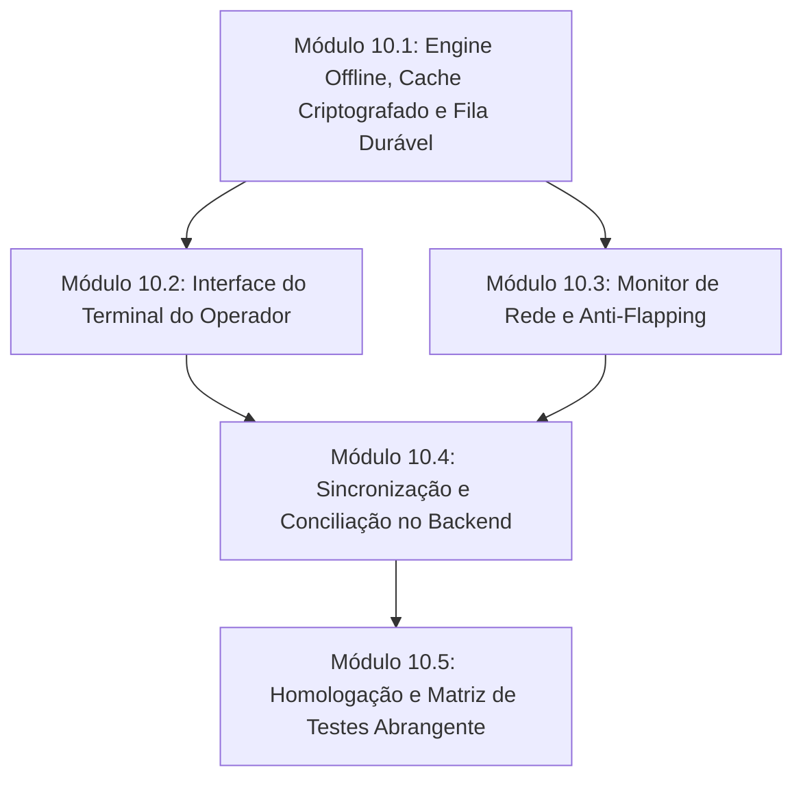

# SPRINT 10 — Plano de Implementação Detalhado
## Terminal de Recepção Operacional e Motor de Contingência Offline Resiliente

**Projeto:** Sistema MA Refeições  
**Fase:** Fase 2 — Consolidação Operacional  
**Sprint:** Sprint 10 [CRÍTICA — P0]  
**Status:** **APROVADO COM AJUSTES OBRIGATÓRIOS** (Revisão v1.1)  
**Documentos de Referência:**  
- [DEVELOPMENT_PLAN.md](file:///c:/Sys_MArefeicoes/docs/DEVELOPMENT_PLAN.md)
- [OFFLINE_STRATEGY.md](file:///c:/Sys_MArefeicoes/docs/OFFLINE_STRATEGY.md)
- [ARCHITECTURE.md](file:///c:/Sys_MArefeicoes/docs/ARCHITECTURE.md)
- [DATABASE.md](file:///c:/Sys_MArefeicoes/docs/DATABASE.md)
- [SECURITY.md](file:///c:/Sys_MArefeicoes/docs/SECURITY.md)

---

## 1. Visão Geral e Diretrizes de Aprovação

A Sprint 10 constrói o ponto focal do atendimento nos restaurantes universitários e industriais: a **interface de liberação contínua de refeições (Terminal do Operador)** e o **Motor de Contingência Offline**.

Seguindo as determinações da avaliação arquitetural, este plano incorpora **7 pilares de segurança e integridade operacional**:
1. **Diferenciação Visual e Lógica Estrita de Estados:** A tela do operador nunca confunde um consumo aprovado online com uma liberação provisória offline.
2. **Criptografia Autenticada e Minimização de Dados Locais:** Cache protegido via Web Crypto API (AES-GCM), com chave derivada e isolamento por unidade e sessão do operador.
3. **Fila Durável e Protegida Contra Descarte:** O IndexedDB protege eventos pendentes mesmo em caso de logout, limpeza acidental de dados de navegação ou atualização da aplicação.
4. **Governança de Saldo e Limites de Risco Offline:** Trava estrita de repetição no mesmo terminal, limites parametrizáveis de contingência e saldo local tratado como informação potencialmente desatualizada.
5. **Separação Contábil/Fiscal de Conflitos Offline:** Quando dois terminais desconectados liberam a mesma matrícula, ambas as entregas físicas são preservadas para auditoria, mas a duplicidade **não gera segundo débito financeiro automático**, sendo classificada como ocorrência pendente de homologação administrativa.
6. **Resiliência de Rede sem Dependência Exclusiva de Background Sync:** Sincronização com retries controlados, backoff exponencial e detecção de conectividade com proteção contra flapping.
7. **Instrumentação de Desempenho (< 400ms):** Medição sistemática de latência por percentis (p50, p95 e p99).

---

## 2. Matriz de Estados Operacionais Explícitos

A arquitetura do terminal gerencia e expõe os seguintes estados discretos:

| Estado | Sigla | Descrição Operacional | Impacto Financeiro / Cota | Feedback Visual |
| :--- | :--- | :--- | :--- | :--- |
| **Consumo Confirmado Online** | `ONLINE_CONFIRMED` | RPC remota `consume_meal` executada com sucesso atômico no Supabase. | Débito efetuado no livro-razão (se parcial) e cota diária preenchida. | 🟢 **Verde Neon** ("LIBERADO ONLINE") |
| **Liberação em Contingência Offline** | `OFFLINE_CONTINGENCY_LOGGED` | Conexão indisponível; validado pelas regras do cache local seguro; registrado na fila durável. | Provisório; aguarda sincronização para conciliação central. Não debita saldo de imediato. | 🟡 **Amarelo / Âmbar** ("LIBERADO OFFLINE - PROVISÓRIO") |
| **Resultado Remoto Desconhecido** | `REMOTE_UNKNOWN_TIMEOUT` | Timeout de rede durante a chamada RPC. O estado no servidor é incerto. | **Trava imediata.** NUNCA libera uma 2ª vez automaticamente. Requer confirmação ou retenção. | 🟠 **Laranja Alerta** ("TIMEOUT DE REDE - VERIFICANDO...") |
| **Pendente de Sincronização** | `PENDING_SYNC` | Evento gravado na fila transacional criptografada do IndexedDB. | Fila auditável durável aguardando janela de transmissão. | Indicador numérico no topo (ex: "3 na fila") |
| **Sincronizado e Confirmado** | `SYNCED_CONFIRMED` | Evento transmitido e aceito pelo backend durante a conciliação. | Efetivado centralmente no banco oficial. | Atualização silenciosa de contador de fila |
| **Conflito sob Revisão Administrativa** | `CONFLICT_PENDING_REVIEW` | Ocorrência de entrega duplicada offline (ex: 2 catracas desconectadas). | Fato físico mantido em log de auditoria. **Sem débito financeiro duplo**. | Registro no relatório de divergências |
| **Não Liberado / Bloqueado** | `BLOCKED` | Rejeição por horário, matrícula inativa, saldo insuficiente ou duplicidade no terminal. | Nenhum débito. Bloqueio registrado para auditoria antifraude. | 🔴 **Vermelho Intenso** (Motivo em destaque) |

---

## 3. Estrutura dos Módulos da Sprint 10

### MÓDULO 10.1 — Engine Offline, Cache Criptografado e Fila Durável (Ajustado)
**Responsabilidade:** Camada de dados local de alta confiabilidade no cliente (IndexedDB + Web Crypto API).

#### 1. Arquitetura de Criptografia e Gestão de Chaves
- Utilização da **Web Crypto API** nativa do navegador (`AES-GCM` com chaves de 256 bits).
- A chave de criptografia local é derivada via `PBKDF2` (com salt gerado aleatoriamente e armazenado na partição do IndexedDB) a partir de um identificador efêmero composto:
  `{ session_token_hash, terminal_id, unit_id }`.
- Nenhuma chave privilegiada (`SUPABASE_SERVICE_ROLE_KEY`) ou credencial administrativa é exposta ou mantida no navegador.
- Toda gravação e leitura no IndexedDB passa pelo pipeline de encriptação/decriptação autenticada com tag de autenticação de 128 bits, prevenindo adulterações manuais via DevTools.

#### 2. Minimização de Dados e Snapshot do Turno (LGPD)
- O cache não armazena o banco completo de alunos. Apenas o **Snapshot do Turno Ativo** da unidade específica:
  - `student_id` (UUID).
  - `registration_hash` e `registration_display` (matrícula sanitizada).
  - `name_display` (nome social ou primeiro/último nome).
  - `category_code` (ex: `BOLSISTA_INTEGRAL`, `PARCIAL`).
  - `is_integral` (boolean).
  - `is_active` (boolean).
  - `estimated_balance` (saldo no momento do download para parciais).
  - `last_cached_at` e `valid_until` (TTL do turno).
- Fotos: Armazenamento em cache de thumbnails apenas se a unidade exigir verificação visual (LRU cache com limite máximo de tamanho).

#### 3. Políticas de Expiração e Proteção da Fila
- **TTL de Validade do Cache:** O cache de alunos expira estritamente ao final da janela de refeição (máximo de 6 horas) ou sob gatilho de novo turno.
- **Isolamento de Stores no IndexedDB:**
  - `students_cache`: Limpável ao encerrar turno ou atualizar snapshot.
  - `pending_sync_queue`: **Estritamente preservada.** Não é descartada em caso de logout do operador, fechamento de aba ou expiração de token. Exige sincronização ou exportação de contingência.
  - `terminal_local_history`: Histórico de passagens do próprio terminal nas últimas 12 horas (utilizado para trava instantânea de duplicidade local).

#### 4. Fila Durável com Encadeamento de Integridade
- Cada evento offline contém:
  - `event_id` (UUID v4).
  - `sequence_num` (inteiro incremental monotônico por terminal).
  - `terminal_id` e `unit_id`.
  - `student_id` e `registration_attempted`.
  - `meal_type_id`.
  - `device_timestamp` (ISO UTC gravado no instante do bip).
  - `verification_method` (`'offline_contingency'`).
  - `idempotency_key` (chave única composta com alta entropia).
  - `previous_event_hash` e `integrity_hash` (cadeia criptográfica HMAC/SHA-256 local que impede exclusão ou inserção de eventos intermediários na fila).

#### 5. Políticas de Autorização e Risco em Modo Offline
- **Estudante Integral:** Permite liberação offline com trava local estrita (o mesmo terminal rejeita imediatamente bip repetido para a mesma refeição).
- **Estudante Parcial:**
  - O saldo local é tratado como **dado potencialmente defasado**.
  - Regra de Risco Padrão: Se o saldo no snapshot for inferior ao valor da refeição (`student_price`), a liberação é rejeitada. Se for suficiente, autoriza **apenas 1 liberação provisória** por turno no terminal, registrando a entrega física.
- **Teto Parametrizável de Contingência:** O terminal bloqueia novas liberações offline ao atingir o limite de segurança da unidade (ex: 50 a 100 refeições offline acumuladas na fila), forçando reconexão ou desbloqueio por supervisor.

---

### MÓDULO 10.2 — Interface do Terminal de Operação Contínua
**Responsabilidade:** Interface do operador rápida, sem necessidade de mouse, com sinalização visual e auditiva.

- **Fluxo 100% Teclado / Scanner USB:**
  - Foco contínuo e automático no input de leitura.
  - Interceptação de buffers de código de barras 1D e QR Code.
  - Teclas de atalho para ações de emergência (ex: `F2` alternar tela cheia, `F8` status de rede, `F9` forçar sincronização).
- **Sinalização Visual Trimodal:**
  - 🟢 **Verde Neon:** "LIBERADO ONLINE" (Consumo confirmado com sucesso pelo Supabase).
  - 🟡 **Amarelo / Âmbar:** "LIBERADO EM CONTINGÊNCIA" (Entrega física autorizada localmente; registro pendente de conciliação).
  - 🟠 **Laranja Alerta:** "RESULTADO DESCONHECIDO (TIMEOUT)" (Operação congelada em análise; não libera repetição às cegas).
  - 🔴 **Vermelho Intenso:** "NÃO LIBERADO" (Exibe motivo claro: "JÁ ALMOÇOU", "SALDO INSUFICIENTE", "TURNO ENCERRADO").
- **Áudio Sintetizado Nativo:** Sons de confirmação, contingência e erro gerados diretamente via Web Audio API (senoides configuradas), sem dependência de download de arquivos MP3.
- **Auto-Reset Inteligente:** Reseta a tela em 1,5 segundos para o próximo aluno, prevenindo bips duplos acidentais do mesmo código no leitor.

---

### MÓDULO 10.3 — Monitor de Rede, Conectividade e Prevenção de Flapping
**Responsabilidade:** Determinação estável do estado de conexão sem alternância frenética (anti-flapping).

- **Janela de Amostragem (Sliding Window):** Não muda de Online para Offline por conta de uma única falha de ping. Exige 3 falhas consecutivas de heartbeat (com timeout de 2.000ms cada) para declarar contingência.
- **Transição Suave (Histerese):** O retorno para modo Online exige 2 sucessos consecutivos de healthcheck com latência aceitável antes de reativar chamadas síncronas.
- **Monitoramento de Latência:** Instrumentação de latência p50, p95 e p99 para aferição da meta de 400ms em modo online.
- **Detecção de Falha na RPC:** Se a chamada para `consume_meal()` expirar por timeout, o sistema classifica a transação como `REMOTE_UNKNOWN_TIMEOUT` e retém o ID de idempotência, impedindo que o operador bipe o mesmo aluno no mesmo segundo.

---

### MÓDULO 10.4 — Sincronização Resiliente e Conciliação de Conflitos
**Responsabilidade:** Transmissão segura dos eventos locais e reconciliação atômica no banco central.

- **Estratégia Híbrida de Sincronização:**
  - Execução principal em primeiro plano no app (via web worker ou pipeline assíncrono com backoff exponencial).
  - Disparadores: Evento `window.addEventListener('online')`, pós-recuperação do healthcheck, e botão manual do operador.
  - Suporte progressivo a Background Sync API (quando disponível no navegador).
- **Processamento no Servidor (RPC `reconcile_offline_consumptions`):**
  - Recebe o lote ordenado por `sequence_num`.
  - Verifica integridade da assinatura do terminal.
  - **Diferenciação de Eventos:**
    1. Se a refeição ainda não foi consumida no dia: registra normalmente em `meal_consumptions` com método `offline_contingency`, efetuando o débito correspondente (se parcial).
    2. Se a refeição já foi consumida em outro terminal durante a janela offline (duplicidade):
       - Grava a ocorrência na tabela `offline_contingency_events` com status `CONFLICT_DUPLICATE`.
       - **NÃO debita a carteira do aluno pela 2ª vez**.
       - Preserva: operador, terminal de origem, carimbo do dispositivo (`device_timestamp`), carimbo do servidor (`server_timestamp`).
       - Disponibiliza para análise de auditoria contratual e fiscal.
- **Confirmação e Expurgamento Idempotente:**
  - O servidor devolve a lista de `event_id` reconciliados com sucesso.
  - O terminal remove da `pending_sync_queue` apenas os itens explicitamente confirmados pelo servidor.

---

### MÓDULO 10.5 — Homologação Operacional e Matriz de Testes Expandida
**Responsabilidade:** Garantir que o sistema opere com estabilidade sob condições adversas.

- **Cenários Mandatórios de Teste:**
  1. Operação online contínua com leitor USB (< 400ms).
  2. Queda súbita de rede e transição transparente para contingência com indicação visual âmbar.
  3. Desconexão simultânea de múltiplos terminais (simulação de 5, 10 e 20 terminais operando offline).
  4. Teste de Colisão Offline: Matrícula integral passando em dois terminais desconectados -> reconciliação registra 1 consumo aprovado e 1 conflito preservado em auditoria sem quebrar integridade.
  5. Teste de Matrícula Parcial Offline: Validação de recusa para saldo insuficiente no snapshot e controle de teto de risco.
  6. Queda durante RPC (timeout no meio da transação) -> retenção segura do estado sem liberação duplicada às cegas.
  7. Fechamento abrupto do navegador / reinicialização da máquina -> fila persiste integralmente no IndexedDB e retoma sincronização.
  8. Manipulação do relógio do cliente -> servidor detecta desvio em relação ao fuso oficial da unidade e sinaliza em auditoria.
  9. Reenvio idempotente de lotes já processados -> nenhuma duplicação no banco.

---

## 4. Roteiro de Execução e Critérios de Aceite

### Critérios de Aceite para Liberação de Produção:
- [ ] Todo consumo liberado em contingência é rotulado visualmente como provisório (âmbar) e nunca como aprovado online.
- [ ] O cache local é armazenado com criptografia autenticada (AES-GCM) e nenhum dado administrativo sensível fica exposto.
- [ ] Registros na fila durável sobrevivem a logout, recarregamento e reinício do computador.
- [ ] Conflitos de duplicidade offline são preservados para auditoria sem gerar débitos financeiros indevidos.
- [ ] A sincronização ocorre de forma idempotente e resiliente sem depender de APIs restritas de navegadores.
- [ ] Build de produção (`npm run build`), testes de regressão e verificação de tipagem aprovados sem erros.
